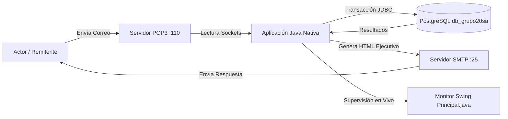
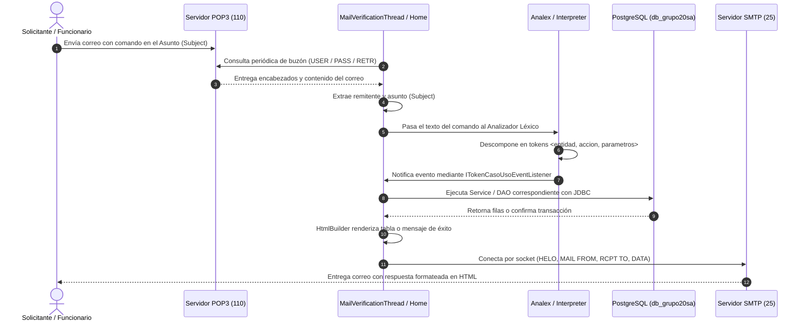

# DISEÑO FUNCIONAL Y BASE DE DATOS
## Sistema de Gestión de Trámites y Firma Digital mediante Comandos por Correo Electrónico
### Vicerrectorado - Universidad Autónoma Gabriel René Moreno (UAGRM)
*Implementación nativa en Java + sockets POP3/SMTP + PostgreSQL (db_grupo20sa)*

---

# 1. Descripción General del Sistema

El sistema permite gestionar trámites académicos y administrativos del Vicerrectorado (Diplomas Académicos, Títulos en Provisión Nacional, Certificados de Calificaciones y Legalizaciones) utilizando el **correo electrónico como interfaz principal de entrada y salida**.

Los usuarios (Alumnos, Docentes, Encargados de Despacho y Vicerrector) no requieren ingresar a un sistema web pesado para sus transacciones: envían un correo electrónico a la casilla oficial del sistema (`grupo20sa@tecnoweb.org.bo` o buzón local de pruebas), donde el asunto contiene el comando a procesar.

El demonio en Java nativo (`MailVerificationThread`) consulta periódicamente el buzón mediante sockets POP3 (puerto 110), extrae el correo, procesa el comando mediante un autómata léxico formal (`Analex` / `Interpreter`), ejecuta la lógica de negocio y transacciones relacionales en **PostgreSQL**, y genera una respuesta ejecutiva en HTML enriquecido con CSS que se envía al remitente vía sockets SMTP (puerto 25) mediante `SendEmail`.

Simultáneamente, la interfaz gráfica Swing (`Principal.java`) permite a los operadores supervisar en tiempo real las conexiones de red, peticiones procesadas y consultar las tablas de datos.

---

# 2. Arquitectura del Sistema



Componentes estructurales:
* **Servidor de Correo (POP3/SMTP):** Provee el buzón del sistema en `mail.tecnoweb.org.bo` (puerto 110 POP3 y puerto 25 SMTP) o contenedor Docker local con GreenMail.
* **Capa de Comunicación (Comunication):** 
  - `MailVerificationThread`: hilo demonio con lectura mediante sockets POP3 sin frameworks.
  - `SendEmail`: envío de correos mediante sockets SMTP con soporte MIME/HTML.
  - `Home`: controlador central que recibe los eventos y orquesta los servicios.
  - `HtmlBuilder`: motor generador de respuestas en HTML ejecutivo con diseño responsive y estilos CSS en línea.
* **Capa de Análisis Léxico y Sintáctico (Utils):**
  - `Cinta`, `Analex`, `Token`, `TokenCommand`: autómata léxico determinista basado en cinta de caracteres para reconocimiento riguroso de comandos.
  - `Interpreter`: intérprete que analiza semánticamente el comando, valida remitente y despacha al listener de eventos.
  - `ParamValidator`: validación estricta de parámetros obligatorios, tipos enteros, fechas y formatos.
* **Capa de Lógica de Negocio (Services):**
  - 17 servicios independientes que aplican las reglas de negocio para cada entidad de los 8 Casos de Uso.
* **Capa de Persistencia (DAO y Database):**
  - Conexión JDBC nativa a PostgreSQL (`Conexion.java`).
  - 17 clases DAO orientadas a sentencias preparadas (`PreparedStatement`) con control de transacciones ACID (`commit` / `rollback`).
* **Base de Datos Relacional PostgreSQL:** Base de datos `db_grupo20sa` con 20 tablas normalizadas con integridad referencial, disparadores y claves foráneas.

---

# 3. Flujo General de Procesamiento de un Correo



1. **Recepción:** El remitente envía un correo con el comando en el **Asunto (Subject)**.
2. **Extracción POP3:** El demonio Java consulta el servidor y extrae los mensajes pendientes.
3. **Análisis Léxico:** `Analex` procesa la cadena del comando caracter por caracter reconociendo los lexemas del vocabulario institucional.
4. **Validación de Parámetros:** `ParamValidator` comprueba cantidad de parámetros requeridos, valores numéricos, fechas y reglas de formato.
5. **Transacción en Base de Datos:** Se ejecuta la operación en PostgreSQL mediante el DAO respectivo dentro de una transacción JDBC segura.
6. **Bitácora y SLA:** Si la operación modifica el estado de un trámite, se registra la traza en `bitacora_tramite` y se computa el estado en `monitoreo_sla`.
7. **Respuesta por SMTP:** `HtmlBuilder` ensambla un documento HTML estructurado con tablas, encabezados azules institucionales y badges de estado, enviándolo al correo del remitente.

---

# 4. Convención de Comandos por Correo

El sistema utiliza la convención formal de compiladores exigida por el Vicerrectorado:
```text
<entidad> <accion> [parametro_1;parametro_2;...;parametro_n]
```

### Reglas Sintácticas:
1. **Ubicación:** El comando se escribe en el **Asunto (Subject)** del correo electrónico.
2. **Separador de parámetros:** Los corchetes `[` y `]` delimitan la lista de argumentos, separados exclusivamente por punto y coma (`;`).
3. **Comandos sin parámetros:** Si la acción no requiere parámetros (como `listar` o `help`), se omite la sección de corchetes.
4. **Comandos de Ayuda:**
   - Asunto `help`: Devuelve el menú general del sistema.
   - Asunto `<entidad> help` (ej: `usuario help`, `tramite help`): Devuelve la sintaxis y ejemplos de esa entidad.

---

# 5. Política Institucional de Credenciales (UAGRM)

Por normativa de seguridad universitaria:
* **Identificadores Estrictamente Numéricos (Sin Letras):**
  - **Alumnos:** Su login es su **Registro Universitario** numérico de 9 dígitos (ej: `219064748`). Su contraseña inicial es su **C.I.**
  - **Docentes:** Su login es su **Código de Docente** numérico de 4 dígitos (ej: `1045`). Su contraseña inicial es su **C.I.**
  - **Autoridades y Encargados:** Su login es su **Código de Funcionario** numérico de 4 dígitos (ej: `1001`, `1002`). Su contraseña inicial es su **C.I.**
* **Diferenciación por Roles:**
  - `ALUMNO`: Solo posee Facultad y Carrera que cursa (no tiene cargo institucional).
  - `DOCENTE`: Vinculado a Facultad, Departamento y categoría académica.
  - `VICERRECTOR`: Máxima autoridad académica; firma legajos y delega atribuciones.
  - `ENCARGADO`: Personal de ventanilla que compila expedientes, valida requisitos y despacha.
  - `ADMINISTRATIVO`: Personal técnico de soporte y seguimiento.
* **Trazabilidad e Inmutabilidad:** Los usuarios con trámites o firmas históricas no pueden ser eliminados físicamente; se desactivan con estado `INACTIVO`.

---

# 6. Detalle de los 8 Casos de Uso del Sistema

## CU1. Gestión de Usuarios
**Actores:** Vicerrector, Encargado, Docentes, Alumnos.  
**Objetivo:** Administrar las cuentas y perfiles institucionales del personal y estudiantes.  
**Tablas:** `usuario`, `alumno`, `docente`, `autoridad`.

**Comandos:**
* `usuario help`
* `usuario listar`
* `usuario agregar [nombre;apellidos;ci;registro;email;rol;telefono;facultad_o_unidad;carrera_o_cargo]`
  - *Ejemplo Alumno:* `usuario agregar [Juan;Perez;4567890;219064748;juan@alu.uagrm.edu.bo;ALUMNO;71000004;FICCT;Ingenieria Informatica]`
  - *Ejemplo Docente:* `usuario agregar [Alberto;Guzman;3456789;1045;aguzman@uagrm.edu.bo;DOCENTE;71000003;FICCT;Docente Titular]`
  - *Ejemplo Encargado:* `usuario agregar [Carlos;Mendoza;2345678;1002;cmendoza@uagrm.edu.bo;ENCARGADO;71000002;Despacho Vicerrectorado;Encargado de Firma]`
* `usuario modificar [id;nombre;apellidos;ci;registro;email;rol;telefono;facultad_o_unidad;carrera_o_cargo;estado]`
* `usuario eliminar [id]`

---

## CU2. Gestión de Delegación de Autoridad e Indicadores de Gestión
**Actores:** Vicerrector, Encargado de Despacho.  
**Objetivo:** Permitir que el Vicerrector Titular transfiera facultades de firma digital a un Encargado durante viajes o ausencias oficiales, y monitorear metas mensuales de gestión.  
**Tablas:** `delegacion_autoridad`, `indicador_gestion`.

**Comandos de Delegación de Autoridad:**
* `delegacion help`
* `delegacion listar`
* `delegacion agregar [id_titular;id_delegado;resolucion;motivo;fecha_inicio;fecha_fin;alcance]`
  - *Alcances permitidos:* `TOTAL`, `SOLO_TITULOS`, `CERTIFICACIONES`.
  - *Ejemplo:* `delegacion agregar [1;2;R-VR-012/2026;Viaje academico CEUB;2026-10-15;2026-10-25;TOTAL]`
* `delegacion modificar [id;resolucion;motivo;fecha_inicio;fecha_fin;alcance;estado]`
* `delegacion eliminar [id]`

**Comandos de Indicadores de Gestión:**
* `indicador help`
* `indicador listar`
* `indicador agregar [codigo;nombre;descripcion;meta;unidad;periodo]`
* `indicador modificar [id;meta;valor_actual;estado]`

---

## CU3. Gestión de Trámites, Requisitos, Documentos y Expediente
**Actores:** Alumnos, Docentes, Encargados.  
**Objetivo:** Iniciar solicitudes académicas oficiales, asociar recaudos documentales en PDF con hash criptográfico SHA-256 y validar su conformidad.  
**Tablas:** `tipo_tramite`, `requisito`, `tramite`, `documento_expediente`.

**Comandos de Tipos de Trámite:**
* `tipo_tramite help`
* `tipo_tramite listar`
* `tipo_tramite agregar [codigo;nombre;descripcion;tiempo_sla;costo]`
  - *Ejemplo:* `tipo_tramite agregar [DIPLOMA_ACAD;Diploma Academico;Emision de Diploma de Grado;72;350.00]`

**Comandos de Trámites:**
* `tramite help`
* `tramite listar`
* `tramite agregar [codigo_tramite;id_solicitante;id_tipo;asunto;prioridad]`
  - *Ejemplo:* `tramite agregar [2026001;4;1;Solicitud Diploma Academico de Licenciatura;NORMAL]`
  - *Regla:* Al registrar el trámite, el sistema inicializa automáticamente el registro de monitoreo en `monitoreo_sla` con 72 horas hábiles.
* `tramite modificar [id;asunto;prioridad;estado]`
* `tramite eliminar [id]`

**Comandos de Documentos del Expediente:**
* `documento help`
* `documento listar`
* `documento agregar [id_tramite;id_requisito;nombre_documento;tipo;url]`
  - *Ejemplo:* `documento agregar [1;1;Cedula_Identidad.pdf;PDF;http://docs.uagrm.edu.bo/1/ci.pdf]`
* `documento validar [id_documento;estado_validacion;observacion]`
  - *Estados:* `APROBADO`, `OBSERVADO`, `RECHAZADO`.

---

## CU4. Enrutamiento de Flujo, Guía Procesal, Observaciones y Bitácora
**Actores:** Encargado, Vicerrector, Solicitante.  
**Objetivo:** Guiar el avance procesal por etapas, registrar instrucciones operativas, gestionar observaciones y conservar la bitácora inmutable de eventos.  
**Tablas:** `flujo_tramite`, `guia_procesal`, `observacion_tramite`, `bitacora_tramite`.

**Comandos de Flujo del Trámite:**
* `flujo help`
* `flujo listar`
* `flujo avanzar [id_tramite;etapa_actual;id_usuario_responsable]`
  - *Ejemplo:* `flujo avanzar [1;REVISION_LEGAL;2]`

**Comandos de Guía Procesal:**
* `guia help`
* `guia listar`
* `guia mostrar [id_tipo_tramite]`
* `guia agregar [id_tipo_tramite;paso_numero;nombre_etapa;descripcion;rol;horas]`

**Comandos de Observaciones:**
* `observacion help`
* `observacion listar`
* `observacion agregar [id_tramite;id_usuario;tipo_observacion;descripcion]`
  - *Ejemplo:* `observacion agregar [1;2;FALTA_REQUISITO;Falta legalizacion de CI]`
* `observacion subsanar [id_observacion;descripcion_subsanacion]`

**Comandos de Bitácora de Auditoría:**
* `bitacora help`
* `bitacora listar`
* `bitacora consultar [id_tramite]`
* `bitacora agregar [id_tramite;id_usuario;accion;detalle]`

---

## CU5. Despacho, Legajos y Firma Digital (Consolidada o Remota)
**Actores:** Vicerrector Titular, Encargado con Delegación.  
**Objetivo:** Consolidar el legajo final, computar su huella criptográfica SHA-256, aplicar firma digital RSA en Base64 vinculada al certificado del firmante y despachar el trámite.  
**Tablas:** `firma_digital`, `despacho_legajo`.

**Comandos de Firma Digital:**
* `firma help`
* `firma listar`
* `firma consolidada [id_tramite;id_firmante;numero_certificado]`
  - Ejecuta la firma digital local/masiva con token criptográfico institucional.
  - Actualiza el estado del trámite automáticamente a `FIRMADO`.
* `firma remota [id_tramite;id_firmante;numero_certificado]`
  - Conecta de forma remota y segura al servicio de firma vicerrectoral (ADSIB).

**Comandos de Despacho de Legajo:**
* `despacho help`
* `despacho listar`
* `despacho agregar [id_tramite;id_usuario_despachador;numero_despacho;tipo_entrega]`
  - *Tipos de entrega:* `DIGITAL_CORREO`, `PORTAL_DESCARGA`, `VENTANILLA`.
  - *Efecto colateral:* Marca el trámite como `DESPACHADO`, sella su fecha final y cierra el SLA en `CUMPLIDO_EN_TIEMPO` o `CUMPLIDO_FUERA_DE_TIEMPO`.

---

## CU6. Certificado Oficial con QR y Portal de Seguimiento Estudiantil
**Actores:** Alumnos, Público General, Encargado.  
**Objetivo:** Emitir el certificado final oficial con código UUID infalsificable y enlace con código QR, permitiendo al estudiante consultar el estado en vivo mediante un PIN secreto.  
**Tablas:** `certificado_oficial`, `portal_seguimiento`.

**Comandos de Certificado Oficial:**
* `certificado help`
* `certificado listar`
* `certificado generar [id_tramite;id_firma;titulo]`
  - Genera automáticamente el UUID único, la URL oficial de validación pública y los datos para el código QR.
* `certificado consultar [codigo_verificacion]`

**Comandos del Portal de Seguimiento con PIN:**
* `portal help`
* `portal listar`
* `portal consultar [pin_seguimiento]`
  - *Ejemplo:* `portal consultar [PIN-8841]`
* `portal habilitar [id_tramite;pin_seguimiento]`

---

## CU7. Monitoreo, Tiempos de Atención y Alertas SLA (72 Horas Hábiles)
**Actores:** Encargado, Vicerrector, Sistema Automático.  
**Objetivo:** Controlar el cumplimiento de la norma vicerrectoral de atención en máximo 72 horas hábiles, alertando tempranamente antes del vencimiento.  
**Tablas:** `monitoreo_sla`, `alerta_sla`.

**Comandos de Monitoreo SLA:**
* `sla help`
* `sla listar`
* `sla verificar [id_tramite]`
  - Computa en tiempo real las horas hábiles consumidas:
    * `EN_TIEMPO`: Trámite dentro del plazo legal.
    * `POR_VENCER`: Restan 24 horas o menos para el vencimiento.
    * `VENCIDO`: Superó las 72 horas hábiles.

**Comandos de Alertas SLA:**
* `alerta help`
* `alerta listar`
* `alerta agregar [id_tramite;tipo_alerta;mensaje;notificado_a]`
* `alerta atender [id_alerta]`

---

## CU8. Reportes y Estadísticas
**Actores:** Vicerrector, Autoridades Universitarias.  
**Objetivo:** Obtener métricas consolidadas sobre el desempeño institucional del Vicerrectorado.  
**Tablas:** `reporte_estadistica` y agregaciones directas sobre `tramite`, `firma_digital`, `monitoreo_sla`.

**Comandos de Reporte:**
* `reporte help`
* `reporte tramites` (Distribución de trámites por estado con porcentaje de avance protegido contra división por cero).
* `reporte sla` (Tasa porcentual de cumplimiento de SLA dentro de las 72 horas hábiles).
* `reporte firmas` (Volumen de firmas emitidas desglosadas por firmante y modalidad consolidada/remota).

---

# 7. Diseño Físico Oficial de la Base de Datos PostgreSQL (`db_grupo20sa`)

A continuación se presenta el script DDL oficial de PostgreSQL que implementa las 20 tablas operativas del sistema:

```sql
-- ============================================================
-- BASE DE DATOS: db_grupo20sa
-- SISTEMA DE FIRMA DIGITAL DEL VICERRECTORADO (UAGRM)
-- ============================================================

-- CU1. GESTION DE USUARIOS
CREATE TABLE usuario (
    id_usuario SERIAL PRIMARY KEY,
    registro VARCHAR(50) UNIQUE NOT NULL,      -- Registro universitario numérico o código de funcionario
    ci VARCHAR(30) UNIQUE NOT NULL,            -- Cédula de Identidad (contraseña inicial)
    password VARCHAR(255) NOT NULL,            -- Contraseña (por defecto idéntica al CI)
    nombre VARCHAR(100) NOT NULL,
    apellidos VARCHAR(100) NOT NULL,
    email VARCHAR(150) UNIQUE NOT NULL,
    telefono VARCHAR(30),
    rol VARCHAR(50) NOT NULL,                  -- 'VICERRECTOR', 'ENCARGADO', 'DOCENTE', 'ALUMNO', 'ADMINISTRATIVO'
    unidad_academica VARCHAR(150),             -- Facultad / Dirección
    cargo VARCHAR(100),                        -- Carrera (para alumnos) o Cargo (para funcionarios)
    estado VARCHAR(30) NOT NULL DEFAULT 'ACTIVO',
    fecha_creacion TIMESTAMP NOT NULL DEFAULT CURRENT_TIMESTAMP,
    fecha_modificacion TIMESTAMP NOT NULL DEFAULT CURRENT_TIMESTAMP,

    CONSTRAINT chk_usuario_rol
        CHECK (rol IN ('VICERRECTOR', 'ENCARGADO', 'DOCENTE', 'ALUMNO', 'ADMINISTRATIVO')),
    CONSTRAINT chk_usuario_estado
        CHECK (estado IN ('ACTIVO', 'INACTIVO', 'SUSPENDIDO'))
);

CREATE TABLE alumno (
    id_alumno INTEGER PRIMARY KEY,
    carrera VARCHAR(120) NOT NULL,
    facultad VARCHAR(120) NOT NULL,
    semestre INTEGER DEFAULT 1,
    estado_academico VARCHAR(50) DEFAULT 'REGULAR',
    CONSTRAINT fk_alumno_usuario
        FOREIGN KEY (id_alumno) REFERENCES usuario(id_usuario) ON DELETE CASCADE
);

CREATE TABLE docente (
    id_docente INTEGER PRIMARY KEY,
    facultad VARCHAR(120) NOT NULL,
    departamento VARCHAR(120),
    categoria_docente VARCHAR(50) DEFAULT 'TIEMPO_COMPLETO',
    CONSTRAINT fk_docente_usuario
        FOREIGN KEY (id_docente) REFERENCES usuario(id_usuario) ON DELETE CASCADE
);

CREATE TABLE autoridad (
    id_autoridad INTEGER PRIMARY KEY,
    tipo_autoridad VARCHAR(50) NOT NULL,       -- 'VICERRECTOR', 'ENCARGADO_DESPACHO'
    resolucion_nombramiento VARCHAR(100),
    fecha_posesion DATE,
    CONSTRAINT fk_autoridad_usuario
        FOREIGN KEY (id_autoridad) REFERENCES usuario(id_usuario) ON DELETE CASCADE
);

-- CU2. DELEGACION DE AUTORIDAD E INDICADORES
CREATE TABLE delegacion_autoridad (
    id SERIAL PRIMARY KEY,
    id_autoridad_titular INTEGER NOT NULL,
    id_autoridad_delegada INTEGER NOT NULL,
    resolucion VARCHAR(100) NOT NULL,
    motivo TEXT NOT NULL,
    fecha_inicio DATE NOT NULL,
    fecha_fin DATE NOT NULL,
    alcance_firma VARCHAR(100) DEFAULT 'TOTAL', -- 'TOTAL', 'SOLO_TITULOS', 'CERTIFICACIONES'
    estado VARCHAR(30) NOT NULL DEFAULT 'ACTIVA',
    fecha_creacion TIMESTAMP NOT NULL DEFAULT CURRENT_TIMESTAMP,

    CONSTRAINT fk_delegacion_titular
        FOREIGN KEY (id_autoridad_titular) REFERENCES usuario(id_usuario),
    CONSTRAINT fk_delegacion_delegado
        FOREIGN KEY (id_autoridad_delegada) REFERENCES usuario(id_usuario),
    CONSTRAINT chk_delegacion_estado
        CHECK (estado IN ('ACTIVA', 'FINALIZADA', 'REVOCADA'))
);

CREATE TABLE indicador_gestion (
    id SERIAL PRIMARY KEY,
    codigo VARCHAR(50) UNIQUE NOT NULL,
    nombre VARCHAR(150) NOT NULL,
    descripcion TEXT,
    meta_esperada NUMERIC(10,2) NOT NULL,
    valor_actual NUMERIC(10,2) DEFAULT 0,
    unidad_medida VARCHAR(30) NOT NULL,        -- 'HORAS', 'PORCENTAJE', 'CANTIDAD'
    periodo VARCHAR(50) DEFAULT 'MENSUAL',     -- 'DIARIO', 'SEMANAL', 'MENSUAL', 'ANUAL'
    estado VARCHAR(30) NOT NULL DEFAULT 'ACTIVO',
    fecha_actualizacion TIMESTAMP DEFAULT CURRENT_TIMESTAMP
);

-- CU3. TRAMITES, REQUISITOS Y DOCUMENTOS
CREATE TABLE tipo_tramite (
    id SERIAL PRIMARY KEY,
    codigo VARCHAR(50) UNIQUE NOT NULL,
    nombre VARCHAR(150) NOT NULL,
    descripcion TEXT,
    tiempo_sla_horas INTEGER NOT NULL DEFAULT 72,
    costo_bs NUMERIC(10,2) DEFAULT 0.00,
    estado VARCHAR(30) NOT NULL DEFAULT 'ACTIVO'
);

CREATE TABLE requisito (
    id SERIAL PRIMARY KEY,
    id_tipo_tramite INTEGER NOT NULL,
    nombre VARCHAR(150) NOT NULL,
    descripcion TEXT,
    es_obligatorio BOOLEAN NOT NULL DEFAULT TRUE,
    formato_permitido VARCHAR(50) DEFAULT 'PDF',
    CONSTRAINT fk_requisito_tipo_tramite
        FOREIGN KEY (id_tipo_tramite) REFERENCES tipo_tramite(id) ON DELETE CASCADE
);

CREATE TABLE tramite (
    id SERIAL PRIMARY KEY,
    codigo_tramite VARCHAR(50) UNIQUE NOT NULL,
    id_usuario_solicitante INTEGER NOT NULL,
    id_tipo_tramite INTEGER NOT NULL,
    asunto VARCHAR(200) NOT NULL,
    estado VARCHAR(50) NOT NULL DEFAULT 'INICIADO',
    prioridad VARCHAR(30) NOT NULL DEFAULT 'NORMAL',
    fecha_solicitud TIMESTAMP NOT NULL DEFAULT CURRENT_TIMESTAMP,
    fecha_finalizacion TIMESTAMP,

    CONSTRAINT fk_tramite_solicitante
        FOREIGN KEY (id_usuario_solicitante) REFERENCES usuario(id_usuario),
    CONSTRAINT fk_tramite_tipo
        FOREIGN KEY (id_tipo_tramite) REFERENCES tipo_tramite(id)
);

CREATE TABLE documento_expediente (
    id SERIAL PRIMARY KEY,
    id_tramite INTEGER NOT NULL,
    id_requisito INTEGER,
    nombre_documento VARCHAR(200) NOT NULL,
    tipo_documento VARCHAR(50) DEFAULT 'PDF',
    archivo_url TEXT,
    hash_documento VARCHAR(128),               -- Hash SHA-256 para integridad criptográfica
    estado_validacion VARCHAR(30) NOT NULL DEFAULT 'PENDIENTE',
    observacion_validacion TEXT,
    fecha_validacion TIMESTAMP,

    CONSTRAINT fk_doc_tramite
        FOREIGN KEY (id_tramite) REFERENCES tramite(id) ON DELETE CASCADE,
    CONSTRAINT fk_doc_requisito
        FOREIGN KEY (id_requisito) REFERENCES requisito(id)
);

-- CU4. GUIA PROCESAL, FLUJO, OBSERVACIONES Y BITACORA
CREATE TABLE guia_procesal (
    id SERIAL PRIMARY KEY,
    id_tipo_tramite INTEGER NOT NULL,
    paso_numero INTEGER NOT NULL,
    nombre_etapa VARCHAR(150) NOT NULL,
    descripcion_instrucciones TEXT NOT NULL,
    rol_responsable VARCHAR(50) NOT NULL,
    tiempo_estimado_horas INTEGER DEFAULT 24,

    CONSTRAINT fk_guia_tipo_tramite
        FOREIGN KEY (id_tipo_tramite) REFERENCES tipo_tramite(id) ON DELETE CASCADE
);

CREATE TABLE flujo_tramite (
    id SERIAL PRIMARY KEY,
    id_tramite INTEGER NOT NULL,
    etapa_actual VARCHAR(100) NOT NULL,
    id_usuario_responsable INTEGER,
    fecha_inicio_etapa TIMESTAMP NOT NULL DEFAULT CURRENT_TIMESTAMP,
    fecha_fin_etapa TIMESTAMP,
    estado_etapa VARCHAR(30) NOT NULL DEFAULT 'EN_PROCESO',

    CONSTRAINT fk_flujo_tramite
        FOREIGN KEY (id_tramite) REFERENCES tramite(id) ON DELETE CASCADE,
    CONSTRAINT fk_flujo_responsable
        FOREIGN KEY (id_usuario_responsable) REFERENCES usuario(id_usuario)
);

CREATE TABLE observacion_tramite (
    id SERIAL PRIMARY KEY,
    id_tramite INTEGER NOT NULL,
    id_usuario INTEGER NOT NULL,
    tipo_observacion VARCHAR(50) NOT NULL,     -- 'FALTA_REQUISITO', 'DOCUMENTO_ILEGIBLE', 'ERROR_DATOS'
    descripcion TEXT NOT NULL,
    estado VARCHAR(30) NOT NULL DEFAULT 'ABIERTA',
    fecha_observacion TIMESTAMP NOT NULL DEFAULT CURRENT_TIMESTAMP,
    fecha_subsanacion TIMESTAMP,

    CONSTRAINT fk_obs_tramite
        FOREIGN KEY (id_tramite) REFERENCES tramite(id) ON DELETE CASCADE,
    CONSTRAINT fk_obs_usuario
        FOREIGN KEY (id_usuario) REFERENCES usuario(id_usuario)
);

CREATE TABLE bitacora_tramite (
    id SERIAL PRIMARY KEY,
    id_tramite INTEGER NOT NULL,
    id_usuario INTEGER,
    accion VARCHAR(100) NOT NULL,
    detalle TEXT,
    ip_origen VARCHAR(45),
    fecha_evento TIMESTAMP NOT NULL DEFAULT CURRENT_TIMESTAMP,

    CONSTRAINT fk_bitacora_tramite
        FOREIGN KEY (id_tramite) REFERENCES tramite(id) ON DELETE CASCADE,
    CONSTRAINT fk_bitacora_usuario
        FOREIGN KEY (id_usuario) REFERENCES usuario(id_usuario)
);

-- CU5. FIRMA DIGITAL Y DESPACHO
CREATE TABLE firma_digital (
    id SERIAL PRIMARY KEY,
    id_tramite INTEGER NOT NULL,
    id_firmante INTEGER NOT NULL,
    tipo_firma VARCHAR(50) NOT NULL,           -- 'CONSOLIDADA' o 'REMOTA'
    algoritmo VARCHAR(50) NOT NULL DEFAULT 'SHA256withRSA',
    hash_documento VARCHAR(128) NOT NULL,
    firma_digital_valor TEXT NOT NULL,
    numero_certificado_digital VARCHAR(100) NOT NULL,
    fecha_firma TIMESTAMP NOT NULL DEFAULT CURRENT_TIMESTAMP,
    valido BOOLEAN NOT NULL DEFAULT TRUE,

    CONSTRAINT fk_firma_tramite
        FOREIGN KEY (id_tramite) REFERENCES tramite(id) ON DELETE CASCADE,
    CONSTRAINT fk_firma_firmante
        FOREIGN KEY (id_firmante) REFERENCES usuario(id_usuario),
    CONSTRAINT chk_tipo_firma
        CHECK (tipo_firma IN ('CONSOLIDADA', 'REMOTA'))
);

CREATE TABLE despacho_legajo (
    id SERIAL PRIMARY KEY,
    id_tramite INTEGER NOT NULL,
    id_usuario_despachador INTEGER NOT NULL,
    numero_despacho VARCHAR(50) UNIQUE NOT NULL,
    legajo_previsualizado_url TEXT,
    tipo_entrega VARCHAR(50) NOT NULL DEFAULT 'DIGITAL_CORREO',
    fecha_despacho TIMESTAMP NOT NULL DEFAULT CURRENT_TIMESTAMP,
    estado VARCHAR(30) NOT NULL DEFAULT 'DESPACHADO',

    CONSTRAINT fk_despacho_tramite
        FOREIGN KEY (id_tramite) REFERENCES tramite(id) ON DELETE CASCADE,
    CONSTRAINT fk_despacho_usuario
        FOREIGN KEY (id_usuario_despachador) REFERENCES usuario(id_usuario)
);

-- CU6. CERTIFICADO CON QR Y PORTAL
CREATE TABLE certificado_oficial (
    id SERIAL PRIMARY KEY,
    id_tramite INTEGER NOT NULL,
    id_firma_digital INTEGER NOT NULL,
    codigo_verificacion VARCHAR(64) UNIQUE NOT NULL,
    qr_data TEXT NOT NULL,
    titulo_documento VARCHAR(200) NOT NULL,
    fecha_emision TIMESTAMP NOT NULL DEFAULT CURRENT_TIMESTAMP,
    fecha_expiracion DATE,
    portal_url VARCHAR(255) NOT NULL,
    estado VARCHAR(30) NOT NULL DEFAULT 'EMITIDO',

    CONSTRAINT fk_cert_tramite
        FOREIGN KEY (id_tramite) REFERENCES tramite(id) ON DELETE CASCADE,
    CONSTRAINT fk_cert_firma
        FOREIGN KEY (id_firma_digital) REFERENCES firma_digital(id)
);

CREATE TABLE portal_seguimiento (
    id SERIAL PRIMARY KEY,
    id_tramite INTEGER UNIQUE NOT NULL,
    pin_seguimiento VARCHAR(20) NOT NULL,
    portal_activo BOOLEAN NOT NULL DEFAULT TRUE,
    total_visitas INTEGER DEFAULT 0,
    ultimo_acceso TIMESTAMP,

    CONSTRAINT fk_portal_tramite
        FOREIGN KEY (id_tramite) REFERENCES tramite(id) ON DELETE CASCADE
);

-- CU7. MONITOREO SLA 72H Y ALERTAS
CREATE TABLE monitoreo_sla (
    id SERIAL PRIMARY KEY,
    id_tramite INTEGER UNIQUE NOT NULL,
    horas_sla_limite INTEGER NOT NULL DEFAULT 72,
    fecha_inicio_sla TIMESTAMP NOT NULL DEFAULT CURRENT_TIMESTAMP,
    fecha_limite_sla TIMESTAMP NOT NULL,
    horas_transcurridas NUMERIC(6,2) DEFAULT 0,
    estado_sla VARCHAR(30) NOT NULL DEFAULT 'EN_TIEMPO',
    alertas_emitidas INTEGER DEFAULT 0,
    ultima_alerta TIMESTAMP,

    CONSTRAINT fk_sla_tramite
        FOREIGN KEY (id_tramite) REFERENCES tramite(id) ON DELETE CASCADE,
    CONSTRAINT chk_estado_sla
        CHECK (estado_sla IN ('EN_TIEMPO', 'POR_VENCER', 'VENCIDO', 'CUMPLIDO_EN_TIEMPO', 'CUMPLIDO_FUERA_DE_TIEMPO'))
);

CREATE TABLE alerta_sla (
    id SERIAL PRIMARY KEY,
    id_monitoreo INTEGER,
    id_tramite INTEGER NOT NULL,
    tipo_alerta VARCHAR(50) NOT NULL,
    mensaje TEXT NOT NULL,
    fecha_alerta TIMESTAMP NOT NULL DEFAULT CURRENT_TIMESTAMP,
    notificado_a VARCHAR(150),
    atendida BOOLEAN NOT NULL DEFAULT FALSE,

    CONSTRAINT fk_alerta_tramite
        FOREIGN KEY (id_tramite) REFERENCES tramite(id) ON DELETE CASCADE
);

-- CU8. REPORTES Y ESTADISTICAS
CREATE TABLE reporte_estadistica (
    id SERIAL PRIMARY KEY,
    id_usuario INTEGER NOT NULL,
    tipo_reporte VARCHAR(100) NOT NULL,
    parametros TEXT,
    resultado_resumen TEXT,
    fecha_generacion TIMESTAMP NOT NULL DEFAULT CURRENT_TIMESTAMP,

    CONSTRAINT fk_reporte_usuario
        FOREIGN KEY (id_usuario) REFERENCES usuario(id_usuario)
);
```

---

# 8. Matriz de Relación de Casos de Uso y Tablas Físicas

| Caso de Uso | Tablas Involucradas | Operaciones Soportadas |
| :--- | :--- | :--- |
| **CU1. Gestión de Usuarios** | `usuario`, `alumno`, `docente`, `autoridad` | `listar`, `agregar`, `modificar`, `eliminar`, `help` |
| **CU2. Delegación e Indicadores** | `delegacion_autoridad`, `indicador_gestion` | `listar`, `agregar`, `modificar`, `eliminar`, `help` |
| **CU3. Trámites y Expediente** | `tipo_tramite`, `requisito`, `tramite`, `documento_expediente` | `listar`, `agregar`, `modificar`, `validar`, `eliminar`, `help` |
| **CU4. Flujo, Guía, Observaciones, Bitácora** | `flujo_tramite`, `guia_procesal`, `observacion_tramite`, `bitacora_tramite` | `listar`, `avanzar`, `mostrar`, `subsanar`, `consultar`, `help` |
| **CU5. Firma Digital y Despacho** | `firma_digital`, `despacho_legajo` | `listar`, `consolidada`, `remota`, `agregar`, `help` |
| **CU6. Certificado Oficial y Portal** | `certificado_oficial`, `portal_seguimiento` | `listar`, `generar`, `consultar`, `habilitar`, `help` |
| **CU7. Monitoreo SLA y Alertas** | `monitoreo_sla`, `alerta_sla` | `listar`, `verificar`, `agregar`, `atender`, `help` |
| **CU8. Reportes y Estadísticas** | `reporte_estadistica`, `tramite`, `firma_digital`, `monitoreo_sla` | `tramites`, `sla`, `firmas`, `help` |

---

# 9. Conclusión y Estado de Implementación

1. **Viabilidad Total:** La arquitectura nativa de Java combinada con sockets directos POP3/SMTP y PostgreSQL `db_grupo20sa` cumple a cabalidad con todos los requerimientos de la materia sin frameworks externos.
2. **Robustez y Auditoría:** Todos los eventos procesados disponen de trazabilidad inmutable mediante `bitacora_tramite`, garantizando auditoría legal vicerrectoral y cumplimiento del SLA de 72 horas.
3. **Mantenibilidad:** El código se encuentra desacoplado en paquetes modulares (`Comunication`, `DAO`, `Services`, `Database`, `Models`, `Utils`) y compila limpiamente sin advertencias, garantizando una ejecución estable en el servidor `mail.tecnoweb.org.bo` y entornos locales con Docker.