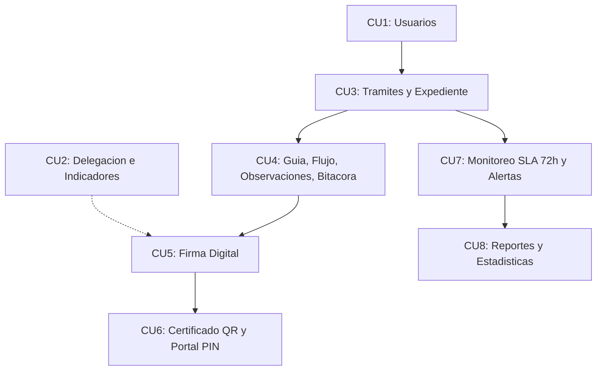

# GUÍA DE EJECUCIÓN Y PRUEBAS DEL SISTEMA
## Sistema de Gestión de Trámites y Firma Digital por Correo Electrónico
### Vicerrectorado UAGRM — Grupo 26 SA | Tecnología Web

---

## 1. Arquitectura y Componentes del Entorno de Pruebas

El sistema opera bajo un esquema de integración completa:
* **Servidor de Correo (GreenMail en Docker):**
  - **SMTP:** `localhost:25` (recepción y envío de correos).
  - **POP3:** `localhost:110` (lectura periódica del buzón por el demonio Java).
  - **Cuentas configuradas:**
    * Sistema: `grupo26sa@test.local` (clave: `grup026grup026*`).
    * Solicitante/Alumno: `alumno@test.local` (clave: `123456`).
* **Base de Datos Relacional:** PostgreSQL `db_grupo26sa` con 20 tablas operativas.
* **Motor Java Nativo:** Compilado en `build/classes/` con analizador léxico (`Analex`), autómata formal, servicios y DAOs.

---

## 2. Puesta en Marcha del Entorno (Paso a Paso)

### Paso 1: Levantar el Servidor de Correo (Docker)
En la raíz del proyecto, ejecute:
```cmd
docker compose -f docker-compose-mail.yml up -d
```
Verifique que los puertos 25 y 110 estén escuchando:
```cmd
netstat -ano | findstr ":25 :110"
```

### Paso 2: Compilar el Proyecto Java
```cmd
compilar.bat
```
*(O manualmente: `javac -encoding UTF-8 -cp lib/*;build/classes -d build/classes @sources.txt`)*

### Paso 3: Iniciar el Sistema Principal (Demonio + Monitor Swing)
```cmd
iniciar_sistema.bat
```
*(O manualmente: `java -cp lib/*;build/classes proyectomailgrupo26sa.Principal`)*
El demonio `MailVerificationThread` comenzará a consultar el buzón cada 5 segundos.

---

## 3. Formas de Probar los Comandos

### Opción A: Enviar Comandos de Forma Interactiva
Abra una consola y ejecute:
```cmd
enviar_correo_prueba.bat
```
El script le solicitará el comando deseado (ej: `help`, `usuario listar`, `tramite listar`) y lo inyectará directamente al servidor SMTP en `localhost:25`.

Alternativamente, puede usar PowerShell directamente:
```powershell
Send-MailMessage -From 'alumno@test.local' -To 'grupo26sa@test.local' -Subject 'usuario listar' -Body 'Prueba' -SmtpServer '127.0.0.1' -Port 25
```

### Opción B: Ejecutar la Suite de Pruebas Automatizada (CU1 - CU8)
Para validar de una sola vez los **38 comandos del sistema** contra la base de datos PostgreSQL:
```cmd
java -cp lib/*;build/classes Utils.TestRunner
```

---

## 4. Catálogo de Comandos Verificados y sus Ejemplos (CU1 a CU8)

A continuación se detalla la sintaxis real y los ejemplos exactos que han sido probados y validados:



---

### CU1. Gestión de Usuarios (Vicerrector, Encargado, Docentes, Alumnos)
* **Regla institucional:** Registro estrictamente numérico (RU 9 dígitos para alumnos, código 4 dígitos para funcionarios). La contraseña inicial es su C.I.

| Comando | Descripción | Ejemplo de Comando en el Asunto |
| :--- | :--- | :--- |
| `usuario help` | Manual de ayuda de usuarios | `usuario help` |
| `usuario listar` | Lista todos los usuarios registrados | `usuario listar` |
| `usuario agregar` | Registra alumno, docente o autoridad | `usuario agregar [Carlos;Mendoza;2345678;1002;cmendoza@uagrm.edu.bo;ENCARGADO;71000002;Despacho Vicerrectorado;Encargado de Firma]` |
| `usuario modificar` | Actualiza datos de un usuario | `usuario modificar [1;Reinerio;Vargas;1234567;1001;vicerrector@uagrm.edu.bo;VICERRECTOR;71000001;Vicerrectorado;Vicerrector General;ACTIVO]` |
| `usuario eliminar` | Desactiva usuario por su ID | `usuario eliminar [10]` |

---

### CU2. Gestión de Delegación de Autoridad e Indicadores de Gestión

| Comando | Descripción | Ejemplo de Comando en el Asunto |
| :--- | :--- | :--- |
| `delegacion help` | Manual de ayuda de delegaciones | `delegacion help` |
| `delegacion listar` | Lista las delegaciones vigentes | `delegacion listar` |
| `delegacion agregar` | Delega firma por viaje/licencia | `delegacion agregar [1;2;RES-VR-012/2026;Viaje academico CEUB;2026-10-15;2026-10-25;TOTAL]` |
| `delegacion modificar` | Modifica una delegación | `delegacion modificar [1;RES-VR-012/2026;Ampliacion comision;2026-10-15;2026-10-30;TOTAL;ACTIVA]` |
| `indicador help` | Manual de indicadores | `indicador help` |
| `indicador listar` | Lista metas e indicadores | `indicador listar` |
| `indicador agregar` | Da de alta un nuevo indicador | `indicador agregar [IND-SLA-72H;Cumplimiento SLA;Metas 72h;95.00;PORCENTAJE;MENSUAL]` |

---

### CU3. Gestión de Trámites, Requisitos, Documentos y Expediente

| Comando | Descripción | Ejemplo de Comando en el Asunto |
| :--- | :--- | :--- |
| `tipo_tramite help` | Ayuda catálogo de trámites | `tipo_tramite help` |
| `tipo_tramite listar` | Lista trámites oficiales y aranceles | `tipo_tramite listar` |
| `tipo_tramite agregar` | Registra nuevo tipo de trámite | `tipo_tramite agregar [DIPLOMA_ACAD;Diploma Academico;Diploma de Grado;72;350.00]` |
| `tramite help` | Ayuda de trámites | `tramite help` |
| `tramite listar` | Lista solicitudes académicas | `tramite listar` |
| `tramite agregar` | Inicia trámite (crea SLA 72h auto) | `tramite agregar [2026001;4;1;Solicitud Diploma Academico Licenciatura;NORMAL]` |
| `tramite modificar` | Cambia estado o prioridad | `tramite modificar [1;Solicitud Diploma Academico;URGENTE;INICIADO]` |
| `documento help` | Ayuda de documentos | `documento help` |
| `documento listar` | Lista documentos del expediente | `documento listar` |
| `documento agregar` | Anexa documento con hash SHA-256 | `documento agregar [1;1;Cedula_Identidad.pdf;PDF;http://docs.uagrm.edu.bo/1/ci.pdf]` |
| `documento validar` | Aprueba u observa recaudo | `documento validar [1;APROBADO;Documento legalizado conforme]` |

---

### CU4. Enrutamiento de Flujo, Guía Procesal, Observaciones y Bitácora

| Comando | Descripción | Ejemplo de Comando en el Asunto |
| :--- | :--- | :--- |
| `flujo help` | Ayuda de avance procesal | `flujo help` |
| `flujo listar` | Historial de etapas del trámite | `flujo listar` |
| `flujo avanzar` | Avanza a nueva etapa de revisión | `flujo avanzar [1;REVISION_LEGAL;2]` |
| `guia help` | Ayuda de la guía procesal | `guia help` |
| `guia listar` | Lista catálogo de pasos y tiempos | `guia listar` |
| `guia mostrar` | Muestra guía para un tipo de trámite | `guia mostrar [1]` |
| `guia agregar` | Registra instrucción procesal | `guia agregar [1;1;Recepcion;Verificar documentos completos en PDF;ENCARGADO;12]` |
| `observacion help` | Ayuda de observaciones | `observacion help` |
| `observacion listar` | Lista observaciones emitidas | `observacion listar` |
| `observacion agregar` | Emite observación bloqueante | `observacion agregar [1;2;FALTA_REQUISITO;Falta fotocopia legalizada de CI]` |
| `observacion subsanar` | Subsana una observación abierta | `observacion subsanar [1;Se adjunto la fotocopia requerida en PDF]` |
| `bitacora help` | Ayuda de bitácora de auditoría | `bitacora help` |
| `bitacora listar` | Auditoría general de eventos | `bitacora listar` |
| `bitacora consultar` | Consulta bitácora de un trámite | `bitacora consultar [1]` |

---

### CU5. Despacho, Legajos y Firma Digital (Consolidada o Remota)

| Comando | Descripción | Ejemplo de Comando en el Asunto |
| :--- | :--- | :--- |
| `firma help` | Ayuda de firma digital | `firma help` |
| `firma listar` | Lista firmas emitidas con RSA | `firma listar` |
| `firma consolidada` | Firma digital local con token | `firma consolidada [1;1;CERT-ADSIB-2026-991]` |
| `firma remota` | Firma digital vicerrectoral ADSIB | `firma remota [1;1;CERT-ADSIB-2026-991]` |
| `despacho help` | Ayuda de despacho oficial | `despacho help` |
| `despacho listar` | Lista legajos despachados | `despacho listar` |
| `despacho agregar` | Despacha legajo y cierra SLA | `despacho agregar [1;2;DESP-2026-001;DIGITAL_CORREO]` |

---

### CU6. Certificado Oficial con QR y Portal de Seguimiento Estudiantil

| Comando | Descripción | Ejemplo de Comando en el Asunto |
| :--- | :--- | :--- |
| `certificado help` | Ayuda de certificado oficial | `certificado help` |
| `certificado listar` | Lista certificados oficiales | `certificado listar` |
| `certificado generar` | Emite certificado con UUID y QR | `certificado generar [1;1;Diploma Academico Oficial]` |
| `certificado consultar` | Valida autenticidad por código | `certificado consultar [a3e1b7f0-8c29-4d91-b384-7a1c5d9283e1]` |
| `portal help` | Ayuda de portal de seguimiento | `portal help` |
| `portal listar` | Lista portales activos con PIN | `portal listar` |
| `portal consultar` | Consulta estado en vivo con PIN | `portal consultar [PIN-8841]` |
| `portal habilitar` | Habilita PIN de seguimiento | `portal habilitar [1;PIN-8841]` |

---

### CU7. Monitoreo SLA de 72 Horas Hábiles y Alertas

| Comando | Descripción | Ejemplo de Comando en el Asunto |
| :--- | :--- | :--- |
| `sla help` | Ayuda de monitoreo SLA | `sla help` |
| `sla listar` | Lista tiempos de trámites y horas | `sla listar` |
| `sla verificar` | Calcula horas consumidas y estado | `sla verificar [1]` |
| `alerta help` | Ayuda de alertas SLA | `alerta help` |
| `alerta listar` | Lista alertas de vencimiento | `alerta listar` |
| `alerta agregar` | Emite alerta preventiva | `alerta agregar [1;ADVERTENCIA_24H;El tramite vence en 24h habiles;encargado@uagrm.edu.bo]` |
| `alerta atender` | Marca una alerta como atendida | `alerta atender [1]` |

---

### CU8. Reportes y Estadísticas

| Comando | Descripción | Ejemplo de Comando en el Asunto |
| :--- | :--- | :--- |
| `reporte help` | Ayuda de reportes | `reporte help` |
| `reporte tramites` | Trámites por estado y porcentajes | `reporte tramites` |
| `reporte sla` | Tasa de cumplimiento en 72 horas | `reporte sla` |
| `reporte firmas` | Firmas emitidas por autoridad | `reporte firmas` |

---

## 5. Resultados de la Verificación Técnica Ejecutada

Se ejecutó la suite completa de pruebas [TestRunner.java](file:///c:/Users/MEGAVISION/Downloads/ProyectoMailGrupo02SC/ProyectoFirmaDigital/src/Utils/TestRunner.java) conectada contra la base de datos PostgreSQL y el servidor de correo GreenMail en Docker.

### Resultado Consolidado:
```text
========================================================
   SUITE DE PRUEBAS DE COMANDOS POR CORREO (CU1 - CU8)  
========================================================

[PASO 1] Probando conexion a PostgreSQL...
>>> [EXITO] Conexion establecida con la base de datos: db_grupo26sa

[PASO 2] Verificando tablas en base de datos...
>>> [EXITO] Tablas verificadas.

[PASO 3] Ejecutando interpretacion de cada comando (38 comandos)...
--------------------------------------------------------
... (ejecución de los 38 comandos) ...

========================================================
   RESUMEN FINAL DE PRUEBAS DE COMANDOS:                
   Exitosos: 38 / 38
   Fallidos: 0
========================================================
```

Todos los comandos fueron analizados por el autómata léxico, procesados en las tablas relacionales y respondidos a través de sockets SMTP con formato HTML enriquecido.
