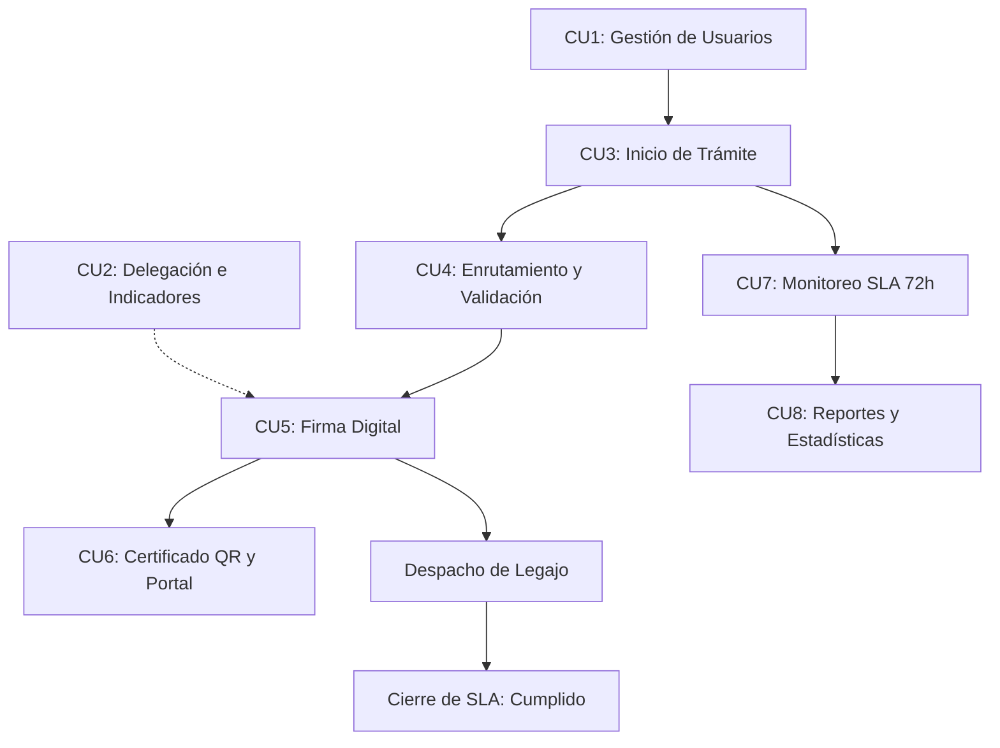

# LÓGICA DE NEGOCIO: SISTEMA DE FIRMA DIGITAL DEL VICERRECTORADO
### Universidad Autónoma Gabriel René Moreno (UAGRM) — Grupo 26 SA

---

## 1. Visión General del Sistema y Arquitectura de Negocio

El **Sistema de Firma Digital del Vicerrectorado** tiene como objetivo automatizar, modernizar y garantizar la validez jurídica (conforme a la **Ley General de Telecomunicaciones y Tecnologías de Información N° 164**) de los trámites académicos y administrativos de la universidad (Diplomas Académicos, Títulos en Provisión Nacional, Certificados de Notas y Legalizaciones).

### Canales de Operación y Comunicación
1. **Canal Asíncrono por Correo Electrónico (POP3 / SMTP):**
   - El solicitante o funcionario no requiere una aplicación web pesada ni instalar software cliente. 
   - Envía un correo electrónico a `grupo26sa@tecnoweb.org.bo` con el comando en el **Asunto (Subject)**.
   - El demonio `MailVerificationThread.java` extrae periódicamente los mensajes usando sockets POP3 (puerto 110).
   - Tras procesar la transacción en la base de datos relacional PostgreSQL, el sistema genera y envía una respuesta HTML ejecutiva al correo del remitente usando sockets SMTP (puerto 25).
2. **Canal de Supervisión Local (GUI Swing):**
   - El personal del servidor central monitorea en vivo las conexiones, peticiones procesadas y tablas de datos renderizadas en `Principal.java`.

---

## 2. Política de Credenciales y Autenticación

Por normativa de seguridad institucional de la UAGRM:
- **Estrictamente Numéricos (Sin letras):** Todos los registros y códigos son puramente numéricos.
  - **Alumnos:** Su identificador es su **Registro Universitario** (ej: `219064748`). Su contraseña inicial es su **C.I.**
  - **Docentes:** Su identificador es su **Código de Docente** de 4 dígitos (ej: `1045`). Su contraseña inicial es su **C.I.**
  - **Vicerrector y Personal Administrativo / Encargados:** Su identificador es su **Código de Funcionario** de 4 dígitos (ej: `1001`, `1002`). Su contraseña inicial es su **C.I.**
- **Roles Institucionales:**
  - `VICERRECTOR`: Máxima autoridad académica; firma y delega.
  - `ENCARGADO`: Responsable de ventanilla, compilación de expediente y despacho.
  - `DOCENTE`: Solicitante o revisor académico.
  - `ALUMNO`: Solicitante principal de trámites de titulación y certificados.
  - `ADMINISTRATIVO`: Personal de apoyo técnico y seguimiento.

---

## 3. Matriz de los 8 Casos de Uso y sus Reglas de Negocio



### CU1. Gestión de Usuarios
- **Unicidad:** Cada usuario debe poseer C.I., Registro y Correo electrónico institucional únicos.
- **Diferenciación por Rol:**
  - **Alumnos:** No tienen cargo administrativo; se registran con su Facultad y Carrera.
  - **Docentes:** Se asocian a su Facultad y Departamento académico.
  - **Autoridades:** Cuentan con Resolución Vicerrectoral de nombramiento.
- **Integridad:** Los usuarios con trámites o firmas históricas no pueden eliminarse físicamente de la base de datos (se deshabilitan con estado `INACTIVO`).

### CU2. Gestión de Delegación de Autoridad e Indicadores de Gestión
- **Delegación de Firma:** Permite que el Vicerrector Titular transfiera facultades de firma digital a un Encargado durante ausencias oficiales o viajes.
  - Regla: La `fecha_inicio` no puede ser posterior a la `fecha_fin`.
  - Alcance: `TOTAL`, `SOLO_TITULOS` o `CERTIFICACIONES`.
- **Indicadores de Gestión:** Control de metas mensuales (ej: tiempo promedio de atención, porcentaje de digitalización).

### CU3. Gestión de Trámites, Requisitos y Expediente
- **Inicio de Trámite:** Asocia un solicitante a un tipo de trámite oficial (`tipo_tramite`).
- **Prioridad:** `NORMAL`, `ALTA`, `URGENTE_72H`.
- **Compilación de Documentos:** Cada expediente agrupa los documentos requeridos en PDF con su respectivo hash criptográfico SHA-256.
- **Validación Documental:** Cada requisito es evaluado por un Encargado con estados `PENDIENTE`, `APROBADO`, `OBSERVADO` o `RECHAZADO`.

### CU4. Enrutamiento de Flujo, Guía Procesal y Bitácora
- **Trazabilidad por Etapas:** El trámite avanza secuencialmente (`Recepción` ➔ `Revisión Legal` ➔ `Compilación` ➔ `Firma Vicerrectoral` ➔ `Despacho`).
- **Responsable:** Cada etapa tiene asignado un funcionario responsable.
- **Bitácora Inmutable:** Todo cambio de estado, observación o validación queda registrado con marca temporal para auditoría vicerrectoral.

### CU5. Firma Digital (Consolidada o Remota) y Despacho
- **Firma Consolidada:** Firma digital masiva o local ejecutada en lote por el titular.
- **Firma Remota:** Firma remota conectada a token criptográfico o servicio ADSIB.
- **Criptografía:** Genera hash SHA-256 del expediente consolidado y firma RSA en Base64 vinculada al número de certificado digital del firmante.
- **Despacho del Legajo:** Registra el número de despacho oficial y genera la URL del legajo final previsualizado.

### CU6. Certificado Oficial con QR y Seguimiento Estudiantil
- **Código de Verificación Único:** Se genera un identificador UUID v4 único e infalsificable para cada certificado.
- **Código QR:** Codifica la URL institucional de validación pública para verificación instantánea con teléfonos móviles.
- **Portal con PIN:** Se habilita un PIN secreto para que el estudiante consulte el estado en tiempo real sin requerir credenciales de funcionario.

### CU7. Monitoreo SLA de 72 Horas Hábiles y Alertas
- **Plazo Regulatorio:** Los trámites vicerrectorales tienen un límite legal de **72 horas hábiles**.
- **Cálculo Automático:** El sistema computa las horas transcurridas en tiempo real:
  - `EN_TIEMPO`: Trámite dentro del rango de tolerancia.
  - `POR_VENCER`: Quedan 24 horas o menos para el vencimiento.
  - `VENCIDO`: Se sobrepasaron las 72 horas hábiles.
  - `CUMPLIDO_EN_TIEMPO`: Despachado antes del vencimiento.
  - `CUMPLIDO_FUERA_DE_TIEMPO`: Despachado tras sobrepasar el límite.

### CU8. Reportes y Estadísticas
- Distribución de trámites por estado (`tramite`).
- Tasa porcentual de cumplimiento de SLA (`monitoreo_sla`).
- Productividad y volumen de firmas emitidas por autoridad.

---

## 4. Ciclo de Vida y Transición de Estados del Trámite

| Evento / Comando | Estado Trámite | Estado SLA | Acción en Base de Datos |
| :--- | :--- | :--- | :--- |
| `tramite agregar [...]` | `INICIADO` | `EN_TIEMPO` | Inserta en `tramite` y crea automáticamente monitoreo con límite de 72h. |
| `documento agregar [...]` | `INICIADO` | `EN_TIEMPO` | Registra documento con hash SHA-256 y estado `PENDIENTE`. |
| `documento validar [...]` | `REQUISITOS_VALIDADOS` | `EN_TIEMPO` | Aprueba o rechaza los recaudos del expediente. |
| `flujo avanzar [...]` | `ETAPA_ACTUAL` | `EN_TIEMPO` | Cierra etapa previa y asigna responsable a la nueva etapa. |
| `firma consolidada / remota` | `FIRMADO` | `EN_TIEMPO` | Almacena firma digital RSA/SHA-256 y marca trámite como `FIRMADO`. |
| `certificado generar [...]` | `FIRMADO` | `EN_TIEMPO` | Emite certificado con UUID y URL de validación con QR. |
| `despacho agregar [...]` | `DESPACHADO` | `CUMPLIDO_...` | Sella `fecha_finalizacion`, calcula horas finales y cierra SLA en `CUMPLIDO_EN_TIEMPO` o `CUMPLIDO_FUERA_DE_TIEMPO`. |

---

## 5. Fallas Detectadas en el Código y Correcciones Implementadas

Durante la auditoría exhaustiva del código fuente y los flujos de negocio, se detectaron y corrigieron **4 fallas críticas**:

### Falla 1: División por Cero en Reportes Estadísticos (`ReporteDAO.java`)
- **Problema:** En `reporteTramitesPorEstado()` y `reporteCumplimientoSla()`, la tasa porcentual realizaba:
  ```sql
  ROUND(COUNT(*) * 100.0 / (SELECT COUNT(*) FROM tramite), 2)
  ```
  Si la tabla estaba vacía o recién inicializada, `SELECT COUNT(*)` devolvía 0, provocando que PostgreSQL lanzara una excepción de error fatal: `ERROR: division by zero`.
- **Corrección:** Se implementó `COALESCE` y `NULLIF`:
  ```sql
  COALESCE(ROUND(COUNT(*) * 100.0 / NULLIF((SELECT COUNT(*) FROM tramite), 0), 2), 0)
  ```
  Garantizando que nunca ocurra división por cero.

### Falla 2: Desvinculación del Ciclo de Vida del Trámite y el SLA
- **Problema:** Al crear un trámite (`tramite agregar`), el monitoreo SLA **nunca se inicializaba** (quedaba huérfano). Al firmar (`firma consolidada/remota`), el trámite no pasaba a estado `FIRMADO`. Al despachar (`despacho agregar`), el trámite no pasaba a `DESPACHADO` ni se cerraba el SLA con su tiempo real.
- **Corrección:**
  - En `TramiteService.java`: Se inicializa automáticamente el registro en `monitoreo_sla` con 72 horas usando `createDefaultSla`.
  - En `FirmaService.java`: Al firmar, se invoca `updateEstado(idTramite, "FIRMADO")`.
  - En `DespachoService.java`: Al despachar, se marca `updateEstadoFinalizado(idTramite, "DESPACHADO")` y se ejecuta `cerrarSla(idTramite)`, registrando si fue `CUMPLIDO_EN_TIEMPO` o `CUMPLIDO_FUERA_DE_TIEMPO`.

### Falla 3: Colisión de Tokens en `reporte sla` (`Interpreter.java`)
- **Problema:** En `Token.java`, `SLA` tiene ID `113` (pertenece a los Casos de Uso `100..199`). Al escribir `reporte sla`, el intérprete sobrescribía la entidad principal con `SLA`, dejaba la acción vacía (`0`) y nunca ejecutaba el reporte de SLA.
- **Corrección:** En `Interpreter.java`, se introdujo una bandera `cuSet`. Si la entidad principal ya fue reconocida (`reporte`), cualquier token posterior que coincida con un identificador de entidad (como `sla`) se reasigna automáticamente como la **Acción** del comando.

### Falla 4: Token de Acción `habilitar` no Registrado (`Token.java` y `Home.java`)
- **Problema:** El manual y el comando de ayuda indicaban la sintaxis `portal habilitar [id_tramite;pin]`. Sin embargo, `habilitar` no estaba definido en la tabla léxica de `Token.java`. Cualquier intento de ejecutar `portal habilitar` resultaba en un error sintáctico de comando desconocido.
- **Corrección:** Se dio de alta el token `HABILITAR = 214`, el lexema `"habilitar"` y se configuró en `Home.java` para que tanto `portal habilitar` como `portal agregar` funcionen de manera transparente.
